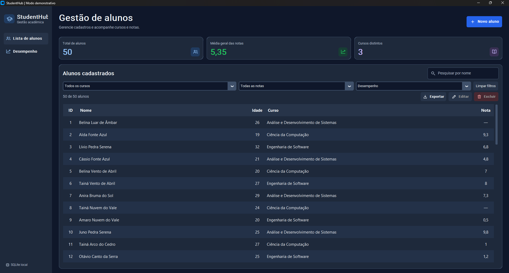
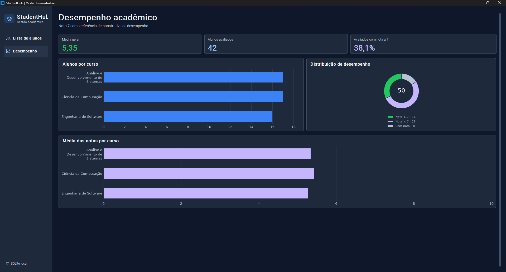
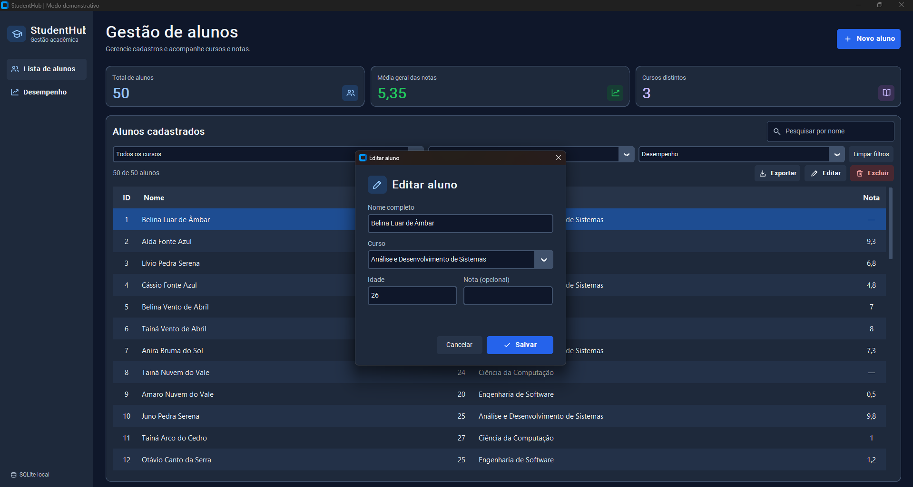
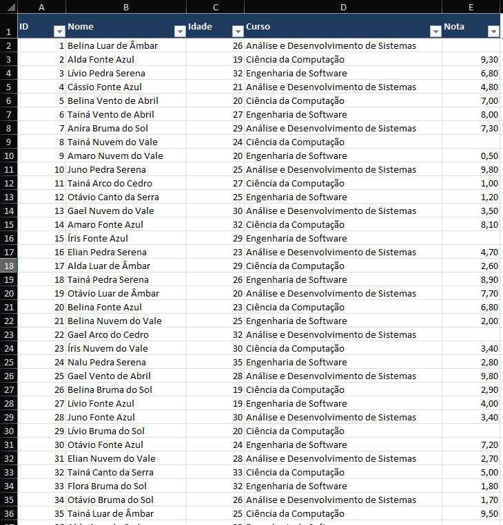

# StudentHub

**Student Management & Academic Analytics**

[Português (Brasil)](#português-brasil) · [English](#english) · [Demonstração / Demo](#demonstração--demo)

[](https://github.com/Eduardo1898/StudentHub/actions/workflows/ci.yml)


## Português (Brasil)

O StudentHub é um aplicativo desktop para organizar cadastros de alunos, acompanhar notas por curso e exportar registros acadêmicos. Foi criado como um trabalho de faculdade em Python e Tkinter e evoluiu de um CRUD local para um projeto de portfólio com módulos separados de interface, persistência, análise e exportação. A interface é em português brasileiro e usa armazenamento SQLite local.

### Funcionalidades

- **Gestão de alunos:** cadastro, consulta, edição e exclusão, com validação e nota opcional de 0 a 10.
- **Pesquisa e filtros:** combine busca por nome, sem distinção de maiúsculas ou acentos, com filtros por curso, faixa de notas e desempenho. Os indicadores da lista refletem todo o cadastro.
- **Desempenho acadêmico:** acompanhe a média geral, o número de alunos avaliados e o percentual de avaliados com nota ≥ 7. Os gráficos mostram alunos por curso, distribuição de desempenho e média por curso. A nota 7 é uma referência demonstrativa. Registros sem nota válida ficam fora das médias e do denominador do percentual.
- **Relatórios:** exporte todos os alunos ou apenas os resultados filtrados para CSV ou Excel. O Excel inclui cabeçalho fixo, autofiltro e colunas formatadas. As notas válidas são numéricas no Excel, e a exportação protege campos de texto contra interpretação como fórmulas.

Veja a [galeria de capturas](#demonstração--demo) e a [estrutura do projeto](#estrutura--project-structure).

### Tecnologias

| Tecnologia | Uso no projeto |
| --- | --- |
| Python, Tkinter, `ttk` e CustomTkinter | Interface desktop, tabela, diálogos e tema escuro |
| SQLite (`sqlite3`) | Persistência local, transações e migração de bancos legados |
| Matplotlib e Pillow | Gráficos integrados à interface e renderização dos ícones |
| Pandas e OpenPyXL | Preparação dos dados para CSV e Excel e formatação do arquivo `.xlsx` |
| `unittest`, GitHub Actions e Xvfb | Testes automatizados, integração contínua e display virtual no Linux |

### Instalação e execução

Instale Git e Python 3.12 ou 3.13, as versões verificadas pela CI. O aplicativo precisa de Tkinter e de uma sessão gráfica. No Debian ou Ubuntu, instale `python3-tk` e `python3-venv` se estiverem ausentes. No macOS, use uma distribuição Python com suporte a Tk.

```sh
git clone https://github.com/Eduardo1898/StudentHub.git
cd StudentHub
```

Os comandos de instalação e execução abaixo devem ser executados na raiz do repositório.

**Windows PowerShell**

```powershell
py -m venv .venv
.\.venv\Scripts\python.exe -m pip install -r requirements.txt
.\.venv\Scripts\python.exe -m src.app
```

**Linux ou macOS**

```sh
python3 -m venv .venv
.venv/bin/python -m pip install -r requirements.txt
.venv/bin/python -m src.app
```

### Modo demonstrativo e armazenamento

Depois de instalar as dependências, gere os dados fictícios e abra a demonstração.

**Windows PowerShell**

```powershell
.\.venv\Scripts\python.exe -m scripts.seed_demo
.\.venv\Scripts\python.exe -m src.app --demo
```

**Linux ou macOS**

```sh
.venv/bin/python -m scripts.seed_demo
.venv/bin/python -m src.app --demo
```

- O modo padrão usa `data/sistema_alunos.db`. O modo demonstrativo usa `data/studenthub_demo.db` e é identificado na barra de título.
- A primeira geração cadastra 50 alunos fictícios nos três cursos com uma seed fixa. Repetir o comando preserva os registros já existentes no banco demonstrativo, inclusive alterações feitas na interface.
- Os bancos e relatórios gerados ficam fora do Git. O banco antigo pode ser importado se o destino padrão ainda estiver ausente. Guarde uma cópia do arquivo legado e acrescente `--banco-legado "caminho/para/sistema_alunos.db"` ao comando padrão de execução. A migração preserva o arquivo de origem.

### Pacote Windows v1.0.0

Para construir o pacote, instale o **Python 3.12 x64** com Tkinter e o launcher `py`. Na raiz do repositório, execute no PowerShell:

```powershell
powershell -NoProfile -ExecutionPolicy Bypass -File .\scripts\build_windows.ps1
& ".\dist\windows\StudentHub\StudentHub.exe"
& ".\dist\windows\StudentHub\StudentHub.exe" --demo
```

O script cria o ambiente de build em `.venv-build/` e gera `dist/windows/StudentHub-v1.0.0-windows-x64.zip`. O pacote PyInstaller é do tipo **onedir** e abre a interface sem console. Para distribuir ou executar a partir do ZIP, extraia a pasta `StudentHub` inteira e mantenha `StudentHub.exe` junto da pasta `_internal`.

- O executável guarda o banco normal e o demonstrativo em `%LOCALAPPDATA%\StudentHub`, em arquivos separados. Na primeira execução com `--demo`, ele cria os 50 registros fictícios. As execuções seguintes preservam as edições.
- Para importar um banco por escolha explícita, acrescente `--banco-legado "C:\caminho\sistema_alunos.db"` ao comando de execução **antes de criar o banco normal do executável**. A importação preserva o arquivo de origem e exige que o destino esteja ausente. A execução pelo código-fonte continua usando `data/`.
- Quando o workflow **Pacote Windows** estiver disponível na branch padrão, abra a aba **Actions**, selecione o workflow e use **Run workflow**. O ZIP fica em **Artifacts** na execução do workflow.

### Testes e integração contínua

Na raiz do repositório, com as dependências instaladas:

```powershell
.\.venv\Scripts\python.exe -m unittest discover -s tests -v
```

```sh
.venv/bin/python -m unittest discover -s tests -v
```

A suíte cobre CRUD, migrações, validações, filtros, indicadores, exportações e isolamento do modo demonstrativo. Os testes usam dados fictícios e arquivos temporários. Os testes de interface precisam de um display. Em Linux sem sessão gráfica, com Xvfb e xauth instalados, execute `xvfb-run -a .venv/bin/python -m unittest discover -s tests -v`.

O [workflow de testes](.github/workflows/ci.yml) roda a cada push e pull request no Linux, com Xvfb e uma matriz de Python 3.12 e 3.13. O badge no início da página acompanha a branch `main`.

### Autoria e uso de IA

**Eduardo Brito** · [GitHub](https://github.com/Eduardo1898) · [LinkedIn](https://www.linkedin.com/in/eduardo-brito-68328435a)

O projeto começou como um trabalho acadêmico de Eduardo Brito. Assistentes de IA apoiaram a evolução do código, dos testes e da documentação.

[Voltar ao início](#studenthub) · [English](#english)

## English

StudentHub is a desktop application for managing student records, tracking grades by course, and exporting academic records. It began as a college assignment built with Python and Tkinter, then evolved from a local CRUD application into a portfolio project with separate modules for the interface, persistence, analytics, and exports. The application interface is in Brazilian Portuguese and uses local SQLite storage.

### Features

- **Student records:** create, view, edit, and delete entries, with field validation and an optional grade from 0 to 10.
- **Search and filters:** combine case- and accent-insensitive name search with course, grade range, and performance filters. The student list's summary cards continue to show figures for the full dataset.
- **Academic analytics:** track the overall average, the number of students with valid grades, and the percentage of those students who scored ≥ 7. Charts show enrollment by course, performance distribution, and average grades by course. A score of 7 is used as a demonstration benchmark. Students without valid grades are excluded from averages and from the percentage denominator.
- **Reports:** export all students or just the filtered rows to CSV or Excel. Excel files include a frozen header, autofilter, and formatted columns. Valid grades are stored as numbers in Excel, and text fields are protected against formula interpretation.

See the [screenshot gallery](#demonstração--demo) and the [project structure](#estrutura--project-structure).

### Technology stack

| Technology | Role in the project |
| --- | --- |
| Python, Tkinter, `ttk`, and CustomTkinter | Desktop interface, table, dialogs, and dark theme |
| SQLite (`sqlite3`) | Local storage, transactions, and legacy database migration |
| Matplotlib and Pillow | Embedded charts and icon rendering |
| Pandas and OpenPyXL | CSV and Excel data preparation and `.xlsx` formatting |
| `unittest`, GitHub Actions, and Xvfb | Automated tests, continuous integration, and a virtual display on Linux |

### Installation and launch

Install Git and Python 3.12 or 3.13, the versions tested in CI. The application requires Tkinter and a graphical session. On Debian or Ubuntu, install `python3-tk` and `python3-venv` if needed. On macOS, use a Python distribution with Tk support.

```sh
git clone https://github.com/Eduardo1898/StudentHub.git
cd StudentHub
```

Run the installation and launch commands below from the repository root.

**Windows PowerShell**

```powershell
py -m venv .venv
.\.venv\Scripts\python.exe -m pip install -r requirements.txt
.\.venv\Scripts\python.exe -m src.app
```

**Linux or macOS**

```sh
python3 -m venv .venv
.venv/bin/python -m pip install -r requirements.txt
.venv/bin/python -m src.app
```

### Demo mode and storage

After installing the dependencies, generate the fictional dataset and launch the demo.

**Windows PowerShell**

```powershell
.\.venv\Scripts\python.exe -m scripts.seed_demo
.\.venv\Scripts\python.exe -m src.app --demo
```

**Linux or macOS**

```sh
.venv/bin/python -m scripts.seed_demo
.venv/bin/python -m src.app --demo
```

- Standard mode uses `data/sistema_alunos.db`. Demo mode uses `data/studenthub_demo.db` and is identified in the window title.
- The first run seeds 50 fictional students across the three courses using a fixed seed. Running the script again preserves existing demo records, including edits made through the application.
- Generated database and report files are excluded from Git. A legacy database can be imported when the default destination does not yet exist. Back up the legacy file and add `--banco-legado "path/to/sistema_alunos.db"` to the standard launch command. The migration preserves the source file.

### Windows v1.0.0 package

To build the package, install **64-bit Python 3.12** with Tkinter and the `py` launcher. From the repository root, run these PowerShell commands:

```powershell
powershell -NoProfile -ExecutionPolicy Bypass -File .\scripts\build_windows.ps1
& ".\dist\windows\StudentHub\StudentHub.exe"
& ".\dist\windows\StudentHub\StudentHub.exe" --demo
```

The script creates a build environment in `.venv-build/` and writes `dist/windows/StudentHub-v1.0.0-windows-x64.zip`. PyInstaller builds an **onedir** application that launches without a console. To distribute or run the ZIP, extract the entire `StudentHub` folder and keep `StudentHub.exe` alongside its `_internal` folder.

- The executable keeps the regular and demo databases in separate files under `%LOCALAPPDATA%\StudentHub`. The first launch with `--demo` creates the 50 fictional records. Later launches preserve edits.
- To import a database explicitly, add `--banco-legado "C:\path\sistema_alunos.db"` to the launch command **before creating the executable's regular database**. Import preserves the source and requires an unused destination. Running from source still uses `data/`.
- Once the **Pacote Windows** workflow is available on the default branch, open **Actions**, select the workflow, and choose **Run workflow**. The ZIP is listed under **Artifacts** for that run.

### Tests and continuous integration

From the repository root, after installing the dependencies:

```powershell
.\.venv\Scripts\python.exe -m unittest discover -s tests -v
```

```sh
.venv/bin/python -m unittest discover -s tests -v
```

The suite covers CRUD operations, migrations, validation, filters, dashboard calculations, exports, and demo isolation. Tests use fictional data and temporary files. UI tests require a display. On headless Linux, with Xvfb and xauth installed, run `xvfb-run -a .venv/bin/python -m unittest discover -s tests -v`.

The [test workflow](.github/workflows/ci.yml) runs on every push and pull request on Linux, using Xvfb and a Python 3.12 and 3.13 matrix. The badge at the top tracks the `main` branch.

### Author and use of AI

**Eduardo Brito** · [GitHub](https://github.com/Eduardo1898) · [LinkedIn](https://www.linkedin.com/in/eduardo-brito-68328435a)

The project began as Eduardo Brito's college assignment. AI assistants supported the development of the code, tests, and documentation.

[Back to top](#studenthub) · [Português (Brasil)](#português-brasil)

## Demonstração / Demo

| Gestão de alunos / Student management | Desempenho acadêmico / Academic dashboard |
| --- | --- |
|  |  |
| **Edição de alunos / Student editing** | **Relatório Excel / Excel report** |
|  |  |

## Estrutura / Project structure

```text
StudentHub/
├── .github/workflows/
│   ├── ci.yml
│   └── windows-build.yml
├── docs/images/
├── packaging/
│   ├── studenthub_entry.py
│   └── windows-version.txt
├── scripts/
│   ├── build_windows.ps1
│   └── seed_demo.py
├── src/
│   ├── app.py
│   ├── componentes.py
│   ├── dashboard.py
│   ├── database.py
│   ├── dialogos.py
│   ├── exportacao.py
│   ├── icones.py
│   ├── painel.py
│   ├── tema.py
│   └── validators.py
├── tests/
├── data/                 # Gerado localmente / Generated locally
├── requirements.txt
├── requirements-build.txt
└── StudentHub.spec
```

| Caminho / Path | Responsabilidade | Responsibility |
| --- | --- | --- |
| `app.py` | Inicialização e navegação | Startup and navigation |
| `componentes.py`, `dialogos.py` | Busca, filtros e formulários | Search, filters, and forms |
| `dashboard.py`, `painel.py` | Gráficos, filtros e cálculos acadêmicos | Charts, filtering, and academic calculations |
| `database.py`, `validators.py` | CRUD, migrações e validação dos dados | CRUD, migrations, and data validation |
| `exportacao.py` | Geração de CSV e Excel | CSV and Excel generation |
| `tema.py`, `icones.py` | Cores, tipografia e ícones | Colors, typography, and icons |
| `scripts/seed_demo.py`, `tests/` | Dados fictícios e suíte de testes | Fictional dataset and test suite |
| `docs/images/`, `.github/workflows/ci.yml` | Capturas e automação de testes | Screenshots and test automation |
| `StudentHub.spec`, `packaging/`, `scripts/build_windows.ps1` | Configuração e construção do pacote Windows | Windows package configuration and build |

[Português (Brasil)](#português-brasil) · [English](#english)
